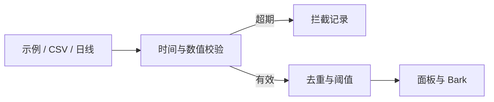

# Market Signal Desk

本地金融市场监控台，提供数据校验、信号筛选、公告去重、可选手机推送和近 24 小时复盘。

公开版由一套实际使用约半年的个人监控系统整理而来。它用独立的示例数据和配置演示监控流程。桌面入口打开本机浏览器面板，账户、持仓、生产策略和券商接口均留在个人系统中。

## 一键开始

先安装 [Python 3.10 或更新版本](https://www.python.org/downloads/)，解压源码包并保留整个目录。首次启动会初始化本机数据目录，尝试创建桌面入口，并打开面板。Python 标准库即可运行。

| 系统 | 启动 |
| --- | --- |
| Windows | 双击 `start.cmd` |
| macOS | 在解压目录打开终端，运行 `sh ./start.sh` |
| Linux | 在解压目录运行 `sh ./start.sh` |

首次打开默认是离线示例。连点「推进一帧」三次，可看到过期输入拦截、有效输入触发信号、同一输入重复出现时保持去重。若系统询问桌面访问权限，可按需授权；拒绝时仍可使用启动脚本。

## 接入自己的数据

1. 在「接入设置」选本地 CSV 或 Alpha Vantage 日线。CSV 栏位见 [示例文件](examples/prices.csv)，旧样例导入后会被标成过期。实时导入需要带时区的时间戳，价格必须为正，变动值以百分数填写。
2. 如选 Alpha Vantage，从[官方入口](https://www.alphavantage.co/support/#api-key)获取自己的 API Key，填写供应商支持的代码，保存后手动刷新一次。内置接入使用日线，免费账户存在额度与数据时效限制。可选的美联储公告源展示标题、时间和原链接。
3. 在 iPhone 安装 [Bark](https://bark.day.app/)，从应用中的示例推送地址取设备 Key，填入面板后保存并点击「发送测试通知」。确认手机收到后，可开启已校验的日线信号推送。合成数据和 CSV 结果仅在面板记录。
4. 可选的后台刷新每 90 分钟运行一次，应用进程关闭后停止。Windows 桌面入口为快捷方式，macOS 为可执行的 `.command`。Linux 桌面目录可用时提供 `.sh`，是否允许双击取决于桌面环境。

## 运行边界

面板监听 `127.0.0.1:8768`。配置、密钥、行情记录和告警保存在本机用户数据目录。界面仅返回密钥是否已配置。保护本机账户与备份，分享演示时只使用源码包。面板使用本地浏览器，无需账户或云端服务。启用联网数据源或 Bark 时，相关请求会发往用户选择的供应商。

旧 CSV 输入、无效时间戳和超过时效窗口的日线只保留为监控记录。阈值触发与告警只表示达到设定条件。项目无券商订单接口。

可通过 `python app.py serve --port 8769` 使用备用端口。从面板点击「停止本机监控」，或在命令行按 Ctrl+C 退出。



运行测试：

```sh
python -m unittest discover -s tests -v
```

来源：[Alpha Vantage 文档](https://www.alphavantage.co/documentation/) · [美联储 RSS](https://www.federalreserve.gov/feeds/feeds.htm) · [Bark 推送接口](https://github.com/Finb/bark-server/blob/master/docs/API_V2.md)。

## English

A local financial market monitor for data validation, signal alerts, source onboarding and review. Start with synthetic replay, then import your own CSV or configure an Alpha Vantage daily data key. Optional Bark alerts and a desktop launcher are built in. Python 3.10+ required.
